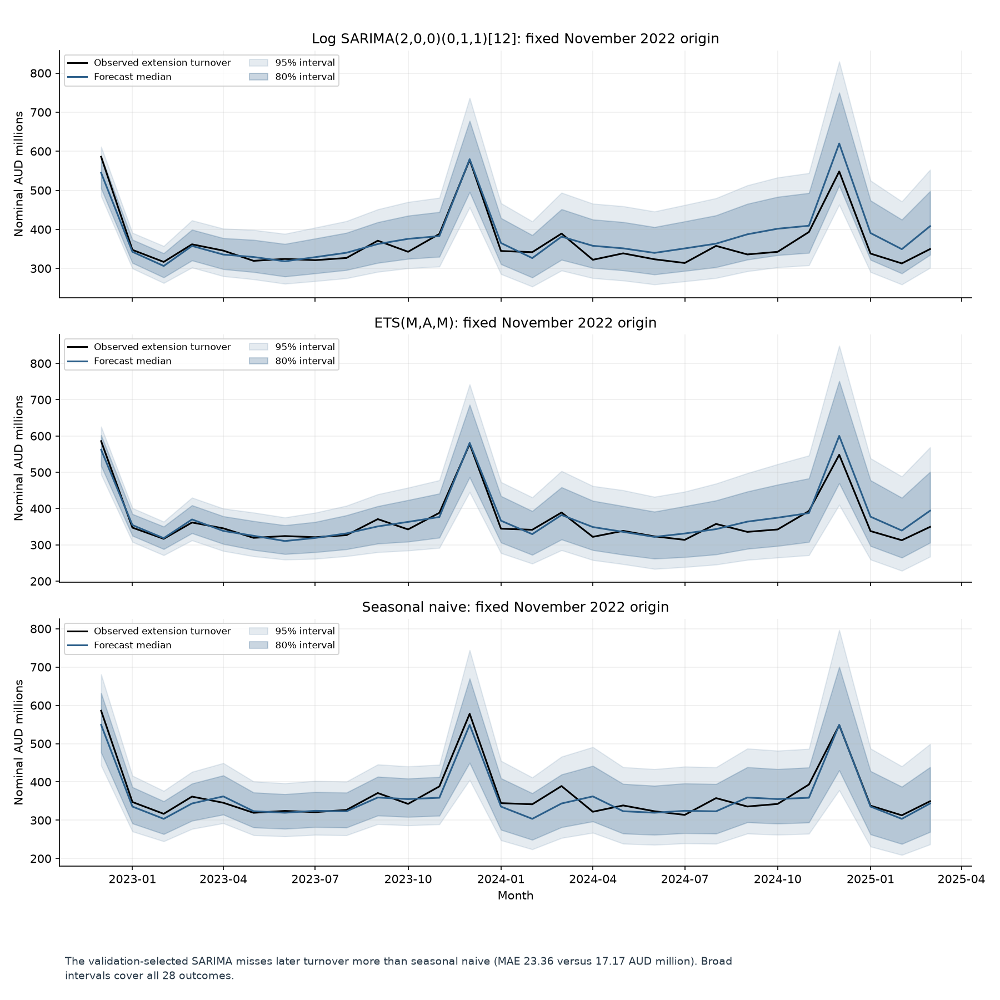

# Victoria retail turnover: keep the seasonal baseline for now

Can a transparent forecasting method improve monthly sector revenue scenarios beyond repeating last year's same month? This notebook compares seasonal naive, ETS and log SARIMA using ABS Victoria liquor retailing turnover in **nominal AUD millions**. The planning context is illustrative industry revenue analysis; no retailer's budget, stock requirement or acceptable error was supplied.

## Finding and decision

Earlier validation selected **log SARIMA(2,0,0)(0,1,1)[12]**, but its later MAE was **36.05% higher than seasonal naive's**. Keep that simple baseline as the reference for a new forward assessment.

| Method | Role | Final MAE, AUD millions | Final RMSE, AUD millions |
|---|---|---:|---:|
| Log SARIMA(2,0,0)(0,1,1)[12] | Selected before final evaluation | 23.36 | 30.72 |
| Seasonal naive | Repeat the latest value for each calendar month | 17.17 | 21.65 |
| ETS(M,A,M) | Best observed final-period comparison | 16.53 | 21.33 |

ETS's lower final MAE makes it a candidate for another assessment. Selecting it after seeing these outcomes requires new forward evidence. The notebook keeps the earlier choice frozen and reports its weaker final result.



The selected SARIMA follows the annual peaks but overestimates later central turnover. All 28 observed months lie inside even the nominal 80% intervals for every method. Those broad ranges cover the misses; they do not establish precise budget bounds or prove calibration.

Read the [executed notebook](victoria_liquor_retail_forecasting.ipynb) for the business problem, all eight embedded figures, their implications and limits, and the technical appendix. The [final metrics](outputs/evaluation_metrics.csv), [row forecasts](outputs/evaluation_predictions.csv) and [consolidated execution summary](outputs/execution_summary.json) support the measured claims.

## Design and limits

Three earlier 24-month validation windows end in November 2018, 2020 and 2022. Their training histories end two years earlier. Average validation MAE selects the configuration. The November 2022 fit then forecasts **December 2022 to March 2025** in one fixed 28-month operation.

Both source snapshots are retained: 488 assignment observations through November 2022 and 516 extension observations through March 2025. Their 488 overlapping values match. Training uses assignment history, with later extension outcomes reserved for evaluation. Unknown historical release vintages and publication lags limit this retrospective experiment.

MAE and RMSE use original revenue units; MASE uses training-only seasonal changes. Median forecasts, mean corrections, interval assumptions and residual checks are explained in the notebook. Nominal industry revenue cannot establish real sales-volume growth, a retailer's performance or a pandemic/policy cause.

The sample ends in **March 2025**. Its April 2025 to March 2027 output is an illustrative forecast from that historical origin, with no supplied later outcomes for scoring. The ABS ended Retail Trade with the [June 2025 reference period](https://www.abs.gov.au/statistics/industry/retail-and-wholesale-trade/retail-trade-australia/jun-2025), released on 31 July 2025. Replacement indicators need a comparability assessment. No current October 2026 forecast, deployment or commercial saving is claimed.

## Run and check

Use **Python 3.12**. `requirements.txt` contains the full pinned dependency closure. On Windows, from this project folder:

```powershell
py -3.12 -m venv .venv
.\.venv\Scripts\python.exe -m pip install -r requirements.txt
.\.venv\Scripts\python.exe .\run_notebook.py
.\.venv\Scripts\python.exe .\run_notebook.py --check
```

On Linux/macOS, use `python3.12 -m venv .venv` and `.venv/bin/python` for the subsequent commands. The runner uses the launching interpreter. No parent portfolio or data download is needed.

The default command runs all cells, checks retained final evidence and newly generated validation/future details, and consolidates execution status, model choice, versions, hashes and check scopes in `outputs/execution_summary.json`. A failed run removes that completion marker. Raw selected data is preserved; generated outputs are overwritten.

`--check` only reads the retained notebook, source snapshots, final predictions/metrics and summary. It recomputes the final comparison, verifies hashes and local links, and needs no `.generated` directory. It does not fit models, write files or independently repeat checks of omitted validation forecasts.

Secondary CSVs, diagnostics, future forecasts and seven separate figure exports regenerate under ignored `.generated/`. The public package keeps the notebook's eight embedded figures and one preview PNG. The data CSVs preserve their bytes through Git to keep source hashes stable. Notebook saves use LF line endings.

For an optional interactive editor, install JupyterLab with the project pins retained: `python -m pip install -c requirements.txt jupyterlab`.

## Sources and authorship

Source: Australian Bureau of Statistics, Retail Trade, Australia, table 11, original series **A3349414R**. [data/README.md](data/README.md) merges the CC BY 4.0 attribution, extraction notes, rights distinction and provenance guidance. The data terms do not select a code or prose license and do not imply ABS endorsement.

